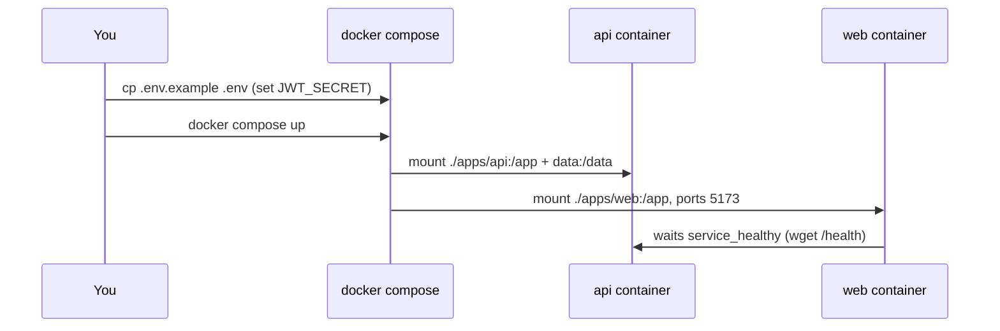
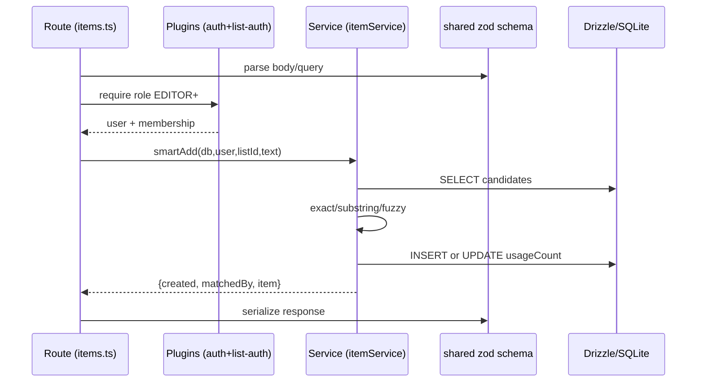
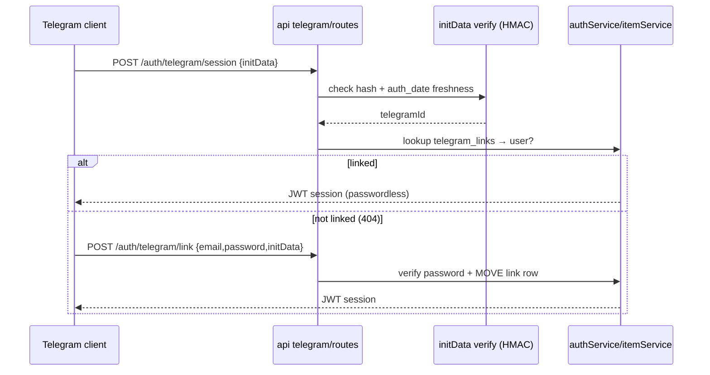
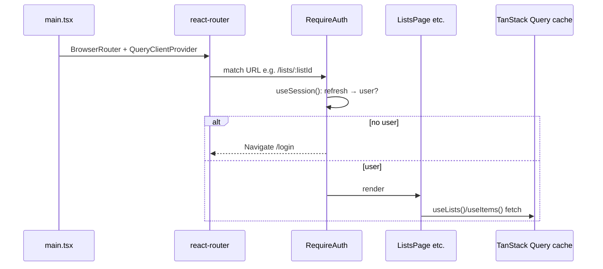
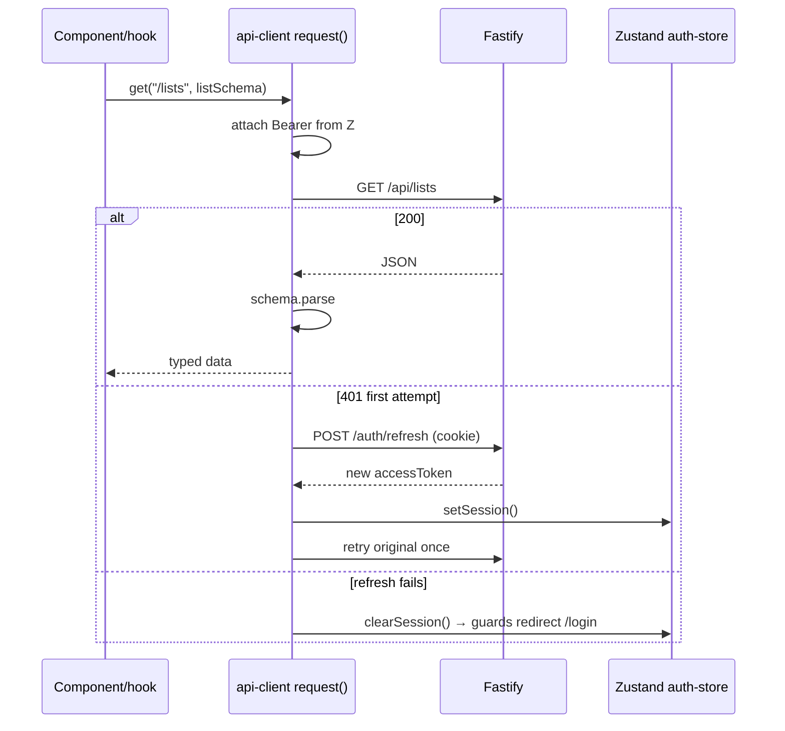
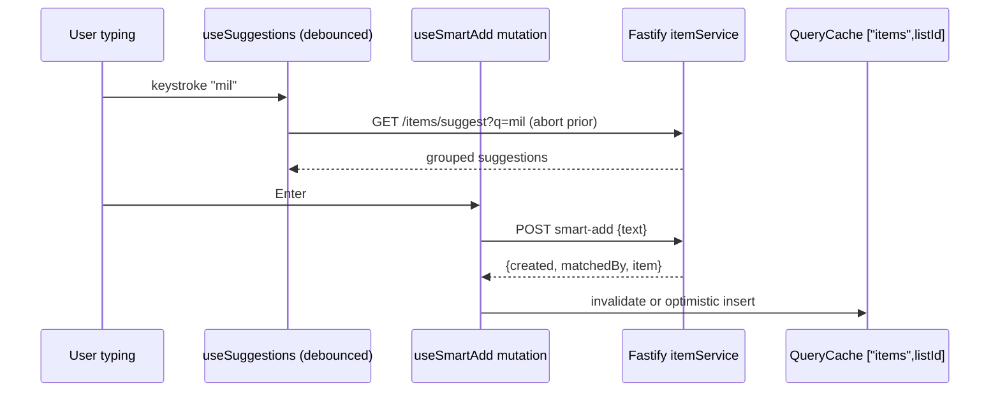

# PROJECT_LEARNING.md — Grocery List, file by file, for a backend developer

> Audience: strong backend experience, ~zero frontend experience.
> Goal: understand how this app is built by reading it in dependency order,
> one functional module at a time.
> Method: for every step — **what to read → what it does → BE analogy → why this library**.

How to use this guide:

1. Read top to bottom. Each step builds on the previous one.
2. Run commands in `bash` blocks to see things live.
3. All `mermaid` blocks render on GitHub / in most Markdown previewers.
4. "Your turn" boxes are small hands-on checks. Do them — FE sticks only by doing.

```bash
cp .env.example .env   # once, set JWT_SECRET
docker compose up      # api :3000, web :5173 (proxies /api + /static → api)
# or native: pnpm install && pnpm dev
```

---

## 0. Big picture first (10 minutes)

### 0.1 What this app is

Self-hosted grocery-list web app + REST API (think "Buy Me a Pie" clone).
Runs on a tiny NAS (Synology DS223j, 1 GB RAM), exposed via Cloudflare Tunnel.
REST API is first-class: humans use the React SPA, AI agents / Telegram / Alice voice assistant use tokens.

### 0.2 Monorepo layout

```text
package.json / pnpm-workspace.yaml / tsconfig.base.json / biome.json / vitest.config.ts
apps/api/        # Node.js + Fastify + Drizzle + SQLite backend
apps/web/        # React 18 + Vite SPA frontend
packages/shared/ # zod schemas + types shared by both (single source of truth)
docs/            # PROJECT.md, ARCHITECTURE.md, DATA_MODEL.md, API.md — normative specs
docker-compose*.yml, apps/*/Dockerfile, apps/web/nginx.conf
scripts/run-next-task.sh, Tasks/
```

BE analogy: monorepo = one repo with `backend/`, `frontend/`, `common/` Maven/Gradle modules.
`pnpm-workspace.yaml` declares members (`apps/*`, `packages/*`); `@grocery/shared` is imported
as `workspace:*` — like a local SNAPSHOT dependency, no registry publish needed.

```mermaid
classDiagram
  class Root {
    +pnpm workspaces
    +biome lint/format
    +vitest run
  }
  class Shared {
    +zod schemas
    +TS types
  }
  class Api {
    +Fastify
    +Drizzle + SQLite
    +bcrypt / JWT
  }
  class Web {
    +React + Vite
    +TanStack Query
    +Zustand
  }
  Root --> Shared : builds first
  Api --> Shared : imports workspace:*
  Web --> Shared : imports workspace:*
  Web --> Api : HTTP /api + /static
```

### 0.3 Runtime topology (dev vs prod)

```mermaid
sequenceDiagram
  participant B as Browser
  participant W as web:5173 (Vite dev) / web:8080 (nginx prod)
  participant A as api:3000 (Fastify)
  participant D as SQLite file (/data/grocery.db)
  participant U as Uploads (/data/images)

  B->>W: GET / (SPA shell, JS bundle)
  B->>W: fetch /api/lists + Bearer JWT
  W->>A: proxy /api/* → /* (strip prefix)
  A->>D: SQL via Drizzle/better-sqlite3
  A-->>B: JSON (validated by zod)
  B->>W: GET /static/&lt;id-hash&gt;.webp
  W->>A: proxy /static as-is
  A->>U: read webp file
```

Key quirk to remember: **Fastify serves routes unprefixed** (`/lists`, `/auth/login`).
The `/api` prefix exists only at the edge (Vite dev proxy, nginx prod) and is stripped there.
`/static` is a real prefix (`@fastify/static`). This confuses every newcomer once — now you know.

---

## Phase 1 — Tooling and contracts (read these before any code)

### Step 1. Root configs — `package.json`, `pnpm-workspace.yaml`, `tsconfig.base.json`, `biome.json`, `vitest.config.ts`

**Read:** those 5 files at repo root.

**What they do:**

| File | Purpose | BE analogy |
|---|---|---|
| `package.json` (root) | Only scripts: `dev` (`pnpm -r --parallel dev`), `build`, `test` (`vitest run`), `lint`/`format` (`biome check`) | Parent POM with aggregator goals |
| `pnpm-workspace.yaml` | Declares `apps/*`, `packages/*` as workspace | Maven `<modules>` |
| `tsconfig.base.json` | Strict TS: `strict`, `noUncheckedIndexedAccess`, `noUnusedLocals`, `verbatimModuleSyntax`, `moduleResolution: Bundler` | `-Werror` + `javac --strict` |
| `biome.json` | Linter + formatter (Biome replaces ESLint+Prettier here) | Checkstyle + Spotless in one binary |
| `vitest.config.ts` | Root test runner; maps `virtual:pwa-register/react` to a stub so node-side `vitest run` doesn't need a service worker | Surefire config + one mock |

**Why pnpm?** Fast, disk-efficient (content-addressed store, like Docker layer sharing),
and its strict `node_modules` layout catches missing dependency declarations that npm would silently allow.
**Why Biome?** Single fast Rust binary for lint+format, zero ESLint plugin hell.
**Why Vitest?** Jest-compatible API but Vite-native (ESM, TS out of the box) — one test runner for API + web + shared.

Your turn: run `pnpm lint && pnpm test` (or `npx vitest run <file>`) and confirm green before touching code.

### Step 2. Environment and Docker — `.env.example`, `docker-compose.yml`, `docker-compose.prod.yml`, `docker-compose.override.yml`

**Read:** `.env.example` → `docker-compose.yml` → `docker-compose.prod.yml`.

**What it does:** `api` (node:20-alpine, dev-server with `--watch`), `web` (node dev server, publishes `5173`),
`tunnel` (cloudflared, profile `tunnel` only). SQLite runs **in-process** — there is no `db` service.
Volumes `data` (`/data/grocery.db`) + `uploads` (`/data/images`) persist state.

**Why no Postgres?** NAS has 1 GB RAM shared with DSM. Postgres idles at ~50–120 MB;
SQLite in-process is < 5 MB and this workload is single-writer, low concurrency.
WAL mode gives readers-writers concurrency without a server process. This is a deliberate
cost decision documented in `README.md` / `docs/ARCHITECTURE.md` — same reason you'd embed
H2/SQLite instead of running a DB pod for a side project.

BE mapping: env var → config bean; named volumes → persistent volumes / hostPath mounts.



### Step 3. The contract package — `packages/shared/src/index.ts` (+ `package.json`, `index.test.ts`)

**Read:** `packages/shared/package.json` → `src/index.ts` (467 lines, read fully — it's the Rosetta Stone).

**What it does:** Every request/response shape as **zod schemas** + inferred TS types:
auth (`loginRequestSchema`), lists, categories (`hexColorSchema`), items, prices (money as decimal
on the wire, `priceCents` integer in DB), suggest/search, images (`MAX_IMAGE_UPLOAD_BYTES = 2MB`),
OAuth-for-Alice constants, Telegram constants, API tokens (`glc_` prefix).

**BE analogy:** Protobuf/Thrift IDL + generated stubs, except the "IDL" is executable:
`z.infer<typeof schema>` gives you the type, `.parse()` gives you runtime validation.
Backend validates inbound, frontend validates outbound ("validate at boundaries" per `docs/CONVENTIONS.md`).

**Why zod (v4)?** One library for validation + types, shared across BE/FE so the contract can't drift.
Alternatives (hand-written TS interfaces, JSON Schema, class-validator) either lack runtime checks
or can't be shared with the frontend bundle cleanly. Here `zod` is the *only* runtime dep of `shared`.

Your turn: pick `createItemRequestSchema` and trace its import in `apps/api/src/routes/items.ts`
and `apps/web/src/features/items/api/items-api.ts`. Same symbol, both sides.

---

## Phase 2 — Backend (`apps/api/`)

Read backend in this order: config → DB → plugins → services → routes → app wiring → extras.

### Step 4. Config — `apps/api/src/config.ts` (+ `config.test.ts`)

**Why zod again here?** `envSchema` parses `process.env` with defaults and coercions
(`z.coerce.number()`), then `loadConfig()` applies **fail-fast production guards**:
`JWT_SECRET`, `CORS_ORIGIN`, `TELEGRAM_*` must be set in prod. This is the 12-factor app pattern:
config from env, validated once at boot, injected as `AppConfig` — like Spring's `@ConfigurationProperties`
with `BindingValidationException` on startup instead of NPE at 3 AM.

Note `CORS_ORIGIN` handling: with `credentials: true`, reflecting any origin is a security hole,
so prod requires an explicit allowlist. Dev defaults to `true` (allow all) for laptop convenience.

### Step 5. Database — `apps/api/src/db/schema.ts`, `client.ts`, `migrate.ts`, `drizzle.config.ts`, `drizzle/`, `scripts/seed.ts`

**Read:** `schema.ts` first (the whole file — it's short and normative, mirrors `docs/DATA_MODEL.md`).

**Tables (mental ER diagram):**

```mermaid
classDiagram
  class users { id(cuid2) email(passwordHash bcrypt) role }
  class refresh_tokens { id userId tokenHash(sha256) expiresAt }
  class api_tokens { id userId tokenHash(sha256 of glc_…) name lastUsedAt }
  class lists { id title ownerId }
  class list_members { listId+userId PK role OWNER/EDITOR/VIEWER }
  class categories { id listId title color sortOrder }
  class items { id listId categoryId title qtyText status sortOrder usageCount imageFilename }
  class price_observations { id itemId priceCents shop observedAt }
  class item_buy_history { id itemId boughtAt }
  class telegram_links { userId PK telegramId }
  class telegram_chat_defaults { chatId PK listId setByUserId }
  class alice_links { userId PK listId }
  class oauth_clients { id secretHash }
  class oauth_codes { id clientId userId codeHash expiresAt usedAt }
  class oauth_tokens { id userId clientId accessHash refreshHash expiresAt revokedAt }

  users ||--o{ refresh_tokens : has
  users ||--o{ api_tokens : has
  users ||--o{ lists : owns
  lists ||--o{ list_members : members
  lists ||--o{ categories : has
  categories ||--o{ items : contains
  items ||--o{ price_observations : priced
  items ||--o{ item_buy_history : bought
```

**BE notes:**

- IDs are `cuid2` (`@paralleldrive/cuid2`) — collision-resistant, URL-safe, sortable-ish,
  no coordination needed (like UUIDv4 but shorter). Generated in app code, not DB sequences.
- Passwords: `bcryptjs` (pure JS bcrypt — no native build, important for ARM Docker builds).
  Tokens/secrets/codes: **sha256 hash only** in DB; plaintext returned once at creation.
  Same discipline as storing only password hashes.
- Money: `priceCents` integer in DB (no float rounding), decimal `price` on the API.
- `categoryId` FK is `onDelete: restrict` — you can't delete a category that still has items
  (service must move/delete items first). Most other FKs are `cascade`.
- `items.usageCount` + `item_buy_history` (last 5 per item) power suggestions and "last bought" badges.

**Why Drizzle ORM + better-sqlite3?**

| Choice | Why | Alternative rejected |
|---|---|---|
| `drizzle-orm` | Thin SQL-like builder, no magic DataMapper, migrations via `drizzle-kit`; tiny memory | Prisma (heavy engine, RAM), TypeORM (decorator magic), raw `sqlite3` (string SQL everywhere) |
| `better-sqlite3` | Synchronous, fastest Node SQLite driver, in-process | `node:sqlite` (newer, less mature at time of writing), `sql.js` (WASM, slower) |
| `drizzle-kit generate/migrate` | Versioned SQL in `drizzle/` | Ad-hoc `CREATE TABLE` in code |

**Why WAL?** See `client.ts` / `ARCHITECTURE.md`: `journal_mode=WAL`, `busy_timeout`, `foreign_keys=ON`.
WAL lets readers proceed while one writer writes — the standard trick for SQLite web apps.
`migrate.ts` runs migrations at boot; `scripts/seed.ts` inserts demo data (`db:seed`).

### Step 6. Fastify plugins — `apps/api/src/plugins/{db,auth,list-auth,error-handler}.ts`, `errors.ts`

**Read:** `db.ts` → `auth.ts` → `list-auth.ts` → `error-handler.ts` + `errors.ts`.

BE analogy: Fastify plugins = Servlet filters / Spring interceptors + DI bindings.
`app.decorate("db", …)` attaches the DB handle to every request (like a request-scoped bean).
`registerDb` injects either real on-disk DB (prod/`index.ts`) or `:memory:` (tests) — constructor injection via `AppDependencies`.

- `auth.ts` (`@fastify/jwt`): verifies `Authorization: Bearer <15-min JWT>`; also accepts `glc_…`
  API tokens and OAuth tokens where appropriate. Short-lived access + rotating refresh is the
  standard " stolen token is useless in 15 min" trade-off.
- `list-auth.ts`: per-list RBAC — loads membership, enforces OWNER > EDITOR > VIEWER.
  Think method-level `@PreAuthorize("hasRole('EDITOR')")` but resolved per resource row.
- `error-handler.ts`: maps domain errors → `{ error: { code, message } }` envelope with correct
  HTTP status (`VALIDATION_ERROR`→400, `UNAUTHORIZED`→401, `FORBIDDEN`→403, `NOT_FOUND`→404,
  `CONFLICT`→409). Frontend's `ApiClientError` parses exactly this shape.

**Why Fastify + these plugins?** Fastify = high-throughput, schema-friendly Express successor
(async handlers, built-in validation hooks, plugin encapsulation). Each `@fastify/*` plugin does one job:
`cookie` (HttpOnly parsing), `cors` (origin allowlist), `helmet` (secure headers),
`multipart` (file upload limits), `static` (serve `/static`), `jwt` (sign/verify).
Like picking Spring Boot starters instead of hand-rolling filters.

### Step 7. Services (pure domain logic) — `apps/api/src/services/*.ts`

**Read in order:** `authService.ts` → `userService.ts` → `listService.ts` → `categoryService.ts` →
`itemService.ts` (+ `textMatching.ts`) → `priceService.ts` → `searchService.ts` → `imageService.ts` → `apiTokenService.ts`.

Services take `(db, …params)` and contain all SQL + rules; routes only do HTTP plumbing.
This is intentional (Anemic-route / Rich-service, a.k.a. hexagonal-ish): services are unit-testable
without HTTP (`itemService.test.ts`, `textMatching.test.ts` are good examples).

Key behaviors to note:

- `authService`: bcrypt compare, issue JWT (15 min) + refresh token (30 d, sha256-stored, rotating,
  HttpOnly `refresh_token` cookie scoped to `/api/auth`), logout revokes.
- `itemService.smartAdd(text)`: exact → substring → fuzzy (`textMatching.ts`: normalization,
  Levenshtein-ish) → create. Returns `{ created, matchedBy, item }` so UI can say "found" vs "created".
- `itemService.move/reorder`: status transitions (`TO_BUY`↔`BOUGHT`), `boughtAt` + `item_buy_history`
  pruning, `sortOrder` rewrite for drag-and-drop.
- `imageService`: `sharp` resizes to 600px webp, content-addressed filename `<id>-<hash>.webp`
  (immutable cache — URL changes on re-upload, so CDN/browser can cache forever).
- `priceService` / `searchService`: cursor pagination (`DEFAULT 50 / MAX 100`), newest-first.



### Step 8. Routes (HTTP adapters) — `apps/api/src/routes/*.ts`

**Read:** `health.ts` → `auth.ts` → `lists.ts` → `categories.ts` → `items.ts` → `prices.ts` → `search.ts` → `users.ts` → `api-tokens.ts`.

Each file = one resource, each `*.test.ts` next to it = contract test via `buildApp` + in-memory DB
(`app.test.ts` shows the pattern: inject fake DB, `app.inject()` HTTP calls, no sockets).
`docs/API.md` is normative — route behavior must match it verbatim.

Special attention:

- `auth.ts`: `POST /auth/login|refresh|logout`, `POST /auth/telegram/session|link` (delegates to telegram service).
- `api-tokens.ts`: `POST /api-tokens` returns plaintext `glc_…` **once**; `GET` lists metadata only.
- `users.ts`: admin-only CRUD (first user bootstrapped as admin — see seed/docs).

### Step 9. App wiring — `apps/api/src/app.ts`, `index.ts`, `dev-server.mjs`, `uploads-probe.ts`

**Read:** `app.ts` (shown above, 112 lines — the whole backend in one glance) → `index.ts` → `uploads-probe.ts`.

`buildApp(config, {db})` registers everything in order: error handler → db → uploads dir →
`helmet/cors/cookie/multipart/static` → `registerAuth` → domain routes → alice/telegram routes.
`index.ts` loads config, opens the real SQLite file, runs migrations, `listen()`.
`uploads-probe.ts` fail-fasts if `/data/images` isn't writable (common named-volume ownership bug)
instead of 500ing on first upload.

### Step 10. Bots and voice — `apps/api/src/telegram/`, `alice/`, `oauth/`

Three independent entry points reusing the same services. Skim in this order:

1. **Telegram** (`telegram/{initData,service,routes,botWebhook,botDialog,extract,botApi,chatDefaults}.ts`):
   `initData` = HMAC-signed query string from Telegram WebApp (verified with bot token — like webhook
   signature verification in Stripe/GitHub). `POST /auth/telegram/link` (email+password once) binds
   `telegram_id`; later `POST /auth/telegram/session` logs in passwordless. `botWebhook` receives
   Bot API updates, `extract` parses free text ("milk 2x") deterministically or via JEV LLM
   (`EXTRACTION_BACKEND=jev`, OpenRouter). `chatDefaults` remembers one list per chat.
2. **Alice / Yandex** (`alice/{protocol,nlu,dialog,webhook,links,tts}.ts` + `oauth/`):
   Standard OAuth2 authorization-code flow against `/oauth/authorize|token` (`oauthService.ts`),
   then voice intents hit `/alice/webhook`. `alice_links` binds one list per user.
3. **Why separate?** Transports differ (HTTP REST vs Bot webhook vs voice JSON), domain doesn't.
   Same `itemService`/`listService` underneath — ports-and-adapters.



---

## Phase 3 — Frontend (`apps/web/`)

> Mindset shift for BE devs: there is no request scope. The SPA is a long-lived stateful client
> (like a desktop app) that talks to your REST API. State lives in three places:
> **server cache** (TanStack Query), **client session** (Zustand), **URL** (React Router).
> Confusing which is which causes most FE bugs.

### Step 11. Build and shell — `apps/web/{package.json,vite.config.ts,index.html,src/main.tsx,src/app.tsx,src/index.css}`

**Why Vite?** Instant dev server (native ESM, no bundling) + optimized prod build (Rollup).
`@vitejs/plugin-react` = JSX + Fast Refresh. Dev proxy (`vite.config.ts`) forwards `/api` (strip prefix)
and `/static` to `api:3000` — mirroring `nginx.conf` so dev ≈ prod topology.

**Why Tailwind CSS v4 (`@tailwindcss/vite`)?** Utility-first styling (`className="flex gap-2 text-sm"`)
instead of separate CSS files / BEM. `index.css` holds the Tailwind import + theme tokens.
Think "inline styles, but constrained to a design system and deduplicated at build".

`main.tsx` = entry: creates `QueryClient`, `BrowserRouter`, mounts `<App/>`.
`app.tsx` = route table (see file above): `/login`, `/` + `/lists/:listId`, item details,
categories, members, `/users`, all wrapped in `RequireAuth` / `RedirectIfAuthenticated` guards.
`UpdateToast` (PWA) floats above everything.



### Step 12. Transport — `apps/web/src/lib/{api-client.ts,api.ts,pwa-config.ts}`, `src/stores/auth-store.ts`

**Read:** `api-client.ts` (fully, 207 lines) → `auth-store.ts` (20 lines) → `api.ts`.

- `createApiClient(adapter)` is a typed `fetch` wrapper: prefixes `API_BASE_PATH` (`/api`),
  attaches `Authorization: Bearer`, `credentials: same-origin` (sends refresh cookie),
  validates every response with the **shared zod schema**, throws `ApiClientError{status,code}`.
  On 401 (except login/refresh paths) it does **single-flight silent refresh** (`POST /auth/refresh`)
  and retries once — concurrent 401s share one refresh promise (`refreshInFlight`).
- `auth-store.ts` (`zustand`): `{ accessToken, user }` in memory only, **never localStorage**
  (XSS would steal a persisted token; in-memory + refresh cookie is the safer split).
  `authAdapter` bridges store ↔ client without import cycles.
- `api.ts` wires singleton `api = createApiClient(authAdapter)`.

**Why Zustand (not Redux)?** Global client state here is tiny (session + a couple UI bits).
Zustand = ~1 KB, hook-based (`useAuthStore(s => s.user)`), no actions/reducers/boilerplate.
Redux Toolkit would be a cannon for a sparrow. Server state stays in TanStack Query (next step),
never in Zustand — that separation is the architecture.



### Step 13. Server-state pattern — one feature end to end (`features/lists/` + `features/auth/`)

**Read:** `features/lists/api/lists-api.ts` → `hooks/use-lists.ts` → `pages/lists-page.tsx` →
`components/*` → `features/auth/hooks/use-session.ts,use-login.ts,use-logout.ts` →
`components/session-guards.tsx`.

Pattern (repeats for every feature):

1. `api/*.ts`: thin functions calling `api.get/post/patch/del(path, sharedSchema)`.
2. `hooks/use-*.ts`: `useQuery({ queryKey, queryFn })` for reads, `useMutation` + `queryClient.invalidateQueries`
   for writes. Query keys include IDs (`["lists"]`, `["lists", id]`, `["items", listId]`).
3. `pages/*.tsx`: compose hooks + presentational components; URL params (`useParams`) are the selected IDs.
4. `components/*.tsx`: dumb render + callbacks (easy to test with Testing Library).

**Why TanStack Query (not `useEffect+fetch`)?** It *is* your client-side cache + request deduplication +
background refetch + retry + optimistic-update plumbing — the equivalent of adding a cache-aside
+ singleflight + stale-while-revalidate layer instead of hand-rolling it per screen.
`@tanstack/react-query` v5 is the standard choice; SWR is the lighter alternative.

**Why React Router v7 (`react-router-dom`)?** URL is the source of truth for navigation
(selected list/item). Deep-linkable, back-button works, refresh keeps context — like server-side
routing, but resolved client-side without full page reloads.

**Why React Hook Form + `@hookform/resolvers` + zod?** Forms (login, create-list, rename) validate
against the *same shared schemas* as the backend; resolvers plug zod into RHF so errors are
per-field and submit is typed. Uncontrolled inputs = fewer re-renders than hand-rolled `useState` per keystroke.

**Why HeadlessUI (`@headlessui/react`)?** Accessible dialogs/menus/listboxes (focus trap, ESC,
ARIA) without styling opinions — pairs with Tailwind. Don't hand-roll modals (a11y bugs guaranteed).

Your turn: open `use-lists.ts`, find `useQuery` + `useMutation`, and note which `invalidateQueries`
fire after create/rename/delete. That's the cache-consistency protocol.

### Step 14. The main screen — `features/items/` (biggest feature, read selectively)

Order: `api/items-api.ts` → `hooks/{use-smart-add,use-suggestions,use-item-mutations,use-item-detail}.ts` →
`lib/{grouping,age-badge,swipe-action}.ts` → `components/{add-item-input,item-row,item-sections}.tsx` →
`pages/item-details-page.tsx`.

- `AddItemInput` + `use-smart-add`: bottom input box → `POST smart-add` → optimistic insert,
  suggestions dropdown from `GET /items/suggest` (debounced, `AbortSignal` cancels stale requests —
  like cancelling superseded futures).
- `item-row` + `use-long-press` + swipe (`swipe-action.ts`): mobile-first gestures; drag-and-drop
  reorder via **`@dnd-kit/{core,sortable,utilities}`** (accessible, touch-friendly DnD; older
  `react-beautiful-dnd` is unmaintained). Reorder posts `orderedIds` array — server rewrites `sortOrder`
  in one transaction (simpler than fractional indexing at this scale).
- `grouping.ts`: groups items by category for sections; `age-badge.ts`: "3 days in list" computed
  from `addedAt` (backend also returns `daysInList`).
- `item-details-page`: edit form, price history chart (**`uplot`** — tiny ~30 KB canvas chart,
  chosen over Chart.js/Recharts for the NAS/mobile budget), `buy-history`, `image-upload`
  (client resizes to 1200px via canvas + `resize-image.ts` before upload; server `sharp` re-resizes
  to 600px webp as safety net — defense in depth for bandwidth + storage).



### Step 15. Remaining features — `categories/`, `members/`, `users/`, `telegram/`, `pwa/`

| Module | Files | Notes for BE dev |
|---|---|---|
| `categories/` | `api/categories-api.ts`, `hooks/use-category-*.ts`, `components/category-*.tsx`, `pages/categories-page.tsx,category-items-page.tsx` | Same Query/mutation pattern; color = `#RRGGBB` validated by shared `hexColorSchema` |
| `members/` | `api/members-api.ts`, `hooks/use-list-detail.ts,use-member-mutations.ts`, `pages/members-page.tsx` | Permission UI over `list_members`; OWNER fixed at creation, only EDITOR/VIEWER assignable (see `assignableListRoleSchema`) |
| `users/` | `api/users-api.ts`, `hooks/use-users.ts,use-user-mutations.ts`, `pages/users-page.tsx` | Admin-only; gate in UI + enforced server-side (never trust the client) |
| `telegram/` | `webapp.ts`, `hooks/use-telegram-link.ts` | `window.Telegram.WebApp.initData` bridge; `notifyTelegramReady()` handshake is a no-op in browsers |
| `pwa/` | `components/update-toast.tsx`, `lib/pwa-config.ts`, `vite-pwa.d.ts` | **PWA** = installable + offline-capable via service worker (`vite-plugin-pwa` generates it; `workbox-window` prompts on update). Manifest icons in `public/`. Offline here = app shell cached; mutations still need network (no local DB sync — deliberate scope cut) |

**Why `vite-plugin-pwa` + `workbox-window`?** Zero-hand-written-SW approach: manifest + precache +
update prompt generated from config. Writing a correct SW update flow by hand is notoriously error-prone.

---

## Phase 4 — Delivery and quality

### Step 16. Prod delivery — `apps/api/Dockerfile`, `apps/web/Dockerfile`, `apps/web/nginx.conf`, `docker-compose.prod.yml`, `scripts/bundle.mjs`

**Read:** `apps/web/nginx.conf` → both Dockerfiles → `docker-compose.prod.yml`.

- `web` image: Vite build → static files served by **nginx** (`nginx.conf`): strip `/api/` prefix
  when proxying to `api:3000`, pass `/static/` and `/oauth/` through, immutable-cache hashed `/assets/`,
  `no-cache` on `index.html`/`sw.js`/manifest, `try_files … /index.html` for SPA deep links
  (server rewrites unknown paths to the shell — like a catch-all controller returning `index.html`).
- `api` image: multi-stage, `tsc` + **esbuild** bundle (`scripts/bundle.mjs`) with native modules
  (`better-sqlite3`, `sharp`) kept external. Note the `node:22-alpine` comment — `better-sqlite3@13`
  segfaults on a specific node:20 patch; the Dockerfile pins around it. Read comments there.
- `cloudflared` tunnel (profile `tunnel`, `TUNNEL_TOKEN`): no inbound ports on the NAS;
  outbound-only tunnel to Cloudflare → `https://grocery.<domain>` → `web:8080`.
  BE analogy: reverse tunnel / `kubectl port-forward` in reverse, managed.

```mermaid
classDiagram
  class Cloudflare {
    +DNS grocery.domain
    +tunnel token
  }
  class WebNginx {
    +/ → SPA shell
    +/api/ → proxy api:3000/
    +/static/ → proxy api:3000
    +/oauth/ → proxy api:3000
  }
  class ApiNode {
    +Fastify bundle
    +SQLite file
    +images dir
  }
  class Cloudflared {
    +outbound tunnel
  }
  Cloudflare --> Cloudflared : ingress
  Cloudflared --> WebNginx : web:8080
  WebNginx --> ApiNode : api:3000
```

Backup = copy the SQLite file + images dir (see `docs/ARCHITECTURE.md`, `docs/DEPLOYMENT*.md`).
No dump tool needed — single file, WAL checkpoint first. Test restores on the laptop, not the NAS.

### Step 17. Tests, types, docs — `*.test.ts(x)`, `docs/`, `Tasks/`

- Tests colocate with code (`routes/*.test.ts`, `features/*/*.test.tsx`): API tests use
  `app.inject()` + `:memory:` DB (no sockets, fast); web tests use Testing Library + jsdom
  (`user-event` for realistic clicks/typing). Run `vitest run` from root.
- `docs/API.md` + `docs/DATA_MODEL.md` are **normative** — code must match them verbatim;
  change the spec in the owning task, not ad hoc. `docs/CONVENTIONS.md` = style/test/git rules.
- `docs/TASKS.md` + `EXECUTION_LOG.md` + `scripts/run-next-task.sh` = how this repo was
  AI-built (one fresh agent per task, verify, one commit). Useful context, not needed to learn the app.

---

## Appendix A — Library cheat-sheet (why not X?)

| Area | Used | Why | Rejected |
|---|---|---|---|
| BE framework | `fastify` 5 | Async-first, plugins, perf; schema hooks | Express (older, slower router), NestJS (heavy DI for this size), Hono (edge-first) |
| Validation | `zod` 4 | Shared BE/FE, inferred types | Joi/Yup (no inference), class-validator (decorators, BE-only) |
| ORM | `drizzle-orm` | Thin, SQL-like, tiny RAM | Prisma (engine RAM), TypeORM (magic) |
| DB | `better-sqlite3` + SQLite WAL | In-process, <5 MB | Postgres (50–120 MB idle — too much for 1 GB NAS) |
| IDs | `@paralleldrive/cuid2` | Short, safe, decentralized | UUID (longer), auto-increment (coordination/leak) |
| Passwords | `bcryptjs` | Pure JS (ARM build safe) | bcrypt native (build pain), argon2 (heavier) |
| Images | `sharp` (BE) + canvas (FE) | Fast resize→webp600; client pre-resize 1200/q0.8 saves bandwidth | jimp (slow), no-resize (2 MB+ uploads on mobile) |
| FE build | `vite` 5 + `@vitejs/plugin-react` | Instant HMR, Rollup prod | CRA/webpack (slow), esbuild-only (no HMR framework) |
| UI | `react` 18 + `react-router-dom` 7 | Standard SPA + URL-as-state | Vue/Svelte (team knows React), Next.js (SSR unneeded for LAN app) |
| Styling | `tailwindcss` 4 + `@headlessui/react` | Utilities + accessible primitives | MUI/Bootstrap (heavy, opinionated look), hand CSS (inconsistent) |
| Server cache | `@tanstack/react-query` 5 | Cache/dedupe/retry/invalidate | Manual fetch (bug farm), Redux+thunk (boilerplate) |
| Client state | `zustand` 5 | 1 KB session store | Redux (overkill), Context alone (re-render storms) |
| Forms | `react-hook-form` + `@hookform/resolvers` | Uncontrolled perf + zod errors | Formik (heavier), hand useState (re-render per keystroke) |
| DnD | `@dnd-kit/*` | Maintained, touch/a11y | react-beautiful-dnd (abandoned) |
| Charts | `uplot` | ~30 KB canvas, fast | Chart.js/Recharts (10x bigger) |
| PWA | `vite-plugin-pwa` + `workbox-window` | Generated SW + update UX | Hand SW (update bugs) |
| Auth | `@fastify/jwt` + `@fastify/cookie` | 15-min JWT + rotating refresh cookie | Sessions in Redis (another process/RAM), Auth.js (overkill) |
| Hardening | `@fastify/helmet,cors,multipart,static` | Headers, CORS, upload limits, static | Hand-rolled middleware (missed edge cases) |
| Tooling | `pnpm`, `biome`, `typescript` strict, `vitest`, `esbuild`, `tsx` | Speed + strictness | npm/yarn, ESLint+Prettier, jest, ts-node |

## Appendix B — Suggested reading order (checklist)

- [ ] Root: `package.json`, `pnpm-workspace.yaml`, `tsconfig.base.json`, `biome.json`, `vitest.config.ts`
- [ ] Env/docker: `.env.example`, `docker-compose.yml`, `docker-compose.prod.yml`
- [ ] Contract: `packages/shared/src/index.ts`
- [ ] API: `config.ts` → `db/schema.ts` → `db/client.ts` → `plugins/*` → `services/authService.ts,userService.ts,listService.ts,categoryService.ts,itemService.ts,textMatching.ts,priceService.ts,searchService.ts,imageService.ts,apiTokenService.ts` → `routes/health,auth,lists,categories,items,prices,search,users,api-tokens.ts` → `app.ts` → `index.ts`
- [ ] Bots: `telegram/initData,service,routes,botWebhook.ts` → `oauth/*` → `alice/webhook,dialog.ts`
- [ ] Web: `vite.config.ts` → `index.html` → `main.tsx` → `app.tsx` → `lib/api-client.ts` → `stores/auth-store.ts` → `lib/api.ts`
- [ ] Feature slice: `features/lists/*` + `features/auth/*`, then `features/items/{api,hooks,lib,components,pages}`, then `categories,members,users,telegram,pwa`
- [ ] Delivery: `apps/web/nginx.conf` → `apps/*/Dockerfile` → `docker-compose.prod.yml` → `docs/ARCHITECTURE.md` → `docs/DEPLOYMENT.md`
- [ ] Norms: `docs/API.md`, `docs/DATA_MODEL.md`, `docs/CONVENTIONS.md`

## Appendix C — Glossary (BE → FE translations)

| You know (BE) | Here (FE) | File |
|---|---|---|
| DTO / IDL | zod schema + inferred type | `packages/shared/src/index.ts` |
| Controller | Route file + Service | `apps/api/src/routes/*`, `services/*` |
| Filter / interceptor | Fastify plugin | `apps/api/src/plugins/*` |
| Request scope | Query cache key + Zustand store + URL | `use-*.ts`, `auth-store.ts`, `app.tsx` |
| Cache-aside + singleflight | TanStack Query + `refreshInFlight` | `use-lists.ts`, `lib/api-client.ts` |
| Connection pool | `better-sqlite3` single handle + WAL | `db/client.ts` |
| Migration tool (Flyway) | `drizzle-kit generate/migrate` | `drizzle/`, `db/migrate.ts` |
| Reverse proxy rules | nginx locations / Vite proxy | `nginx.conf`, `vite.config.ts` |
| Cron/backup dump | Copy `.db` + images (WAL checkpoint) | `docs/ARCHITECTURE.md` |
| Servlet container | Vite dev server / nginx static | `vite.config.ts`, `nginx.conf` |
