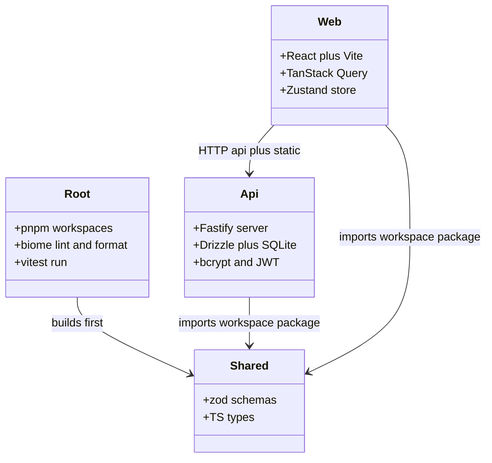
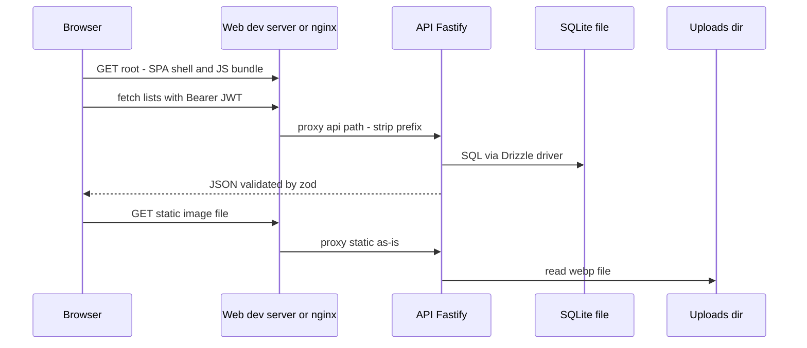
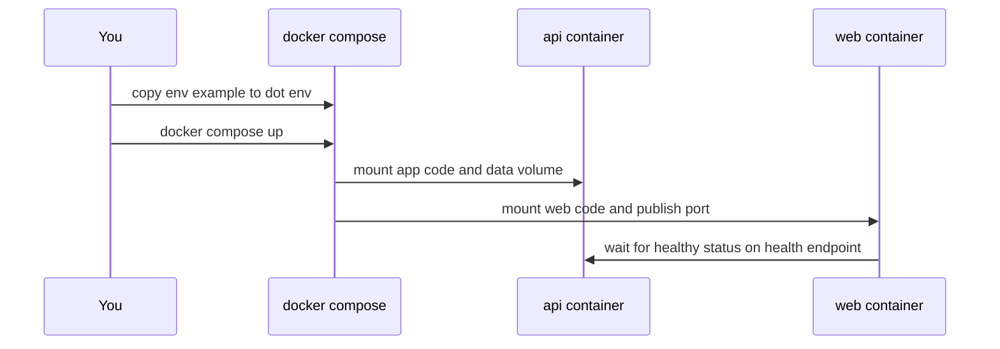
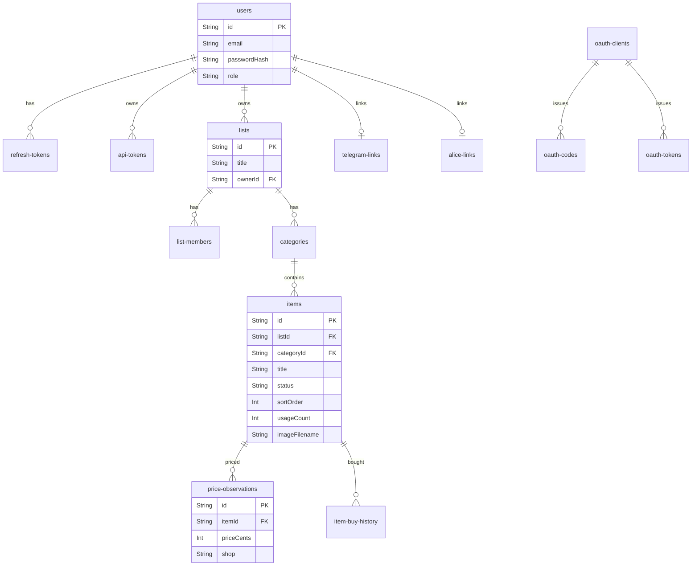
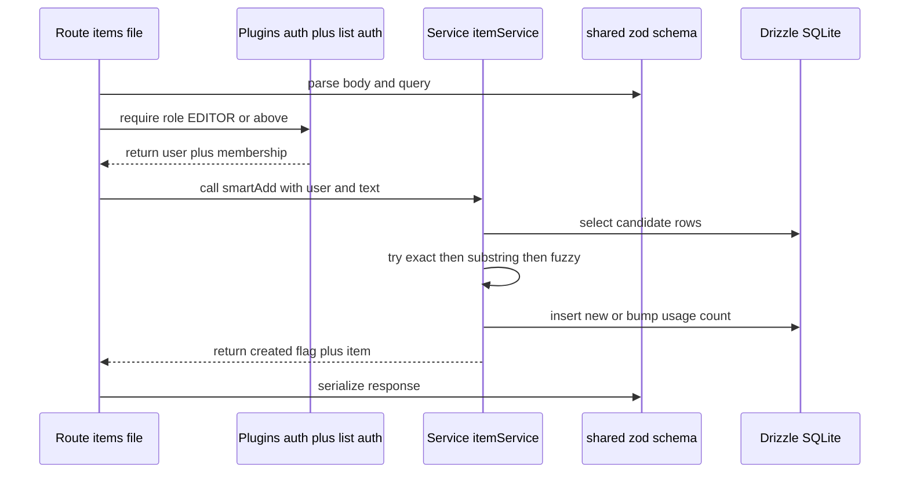
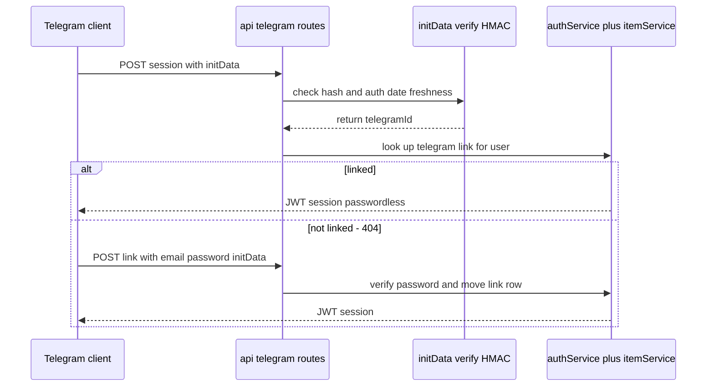
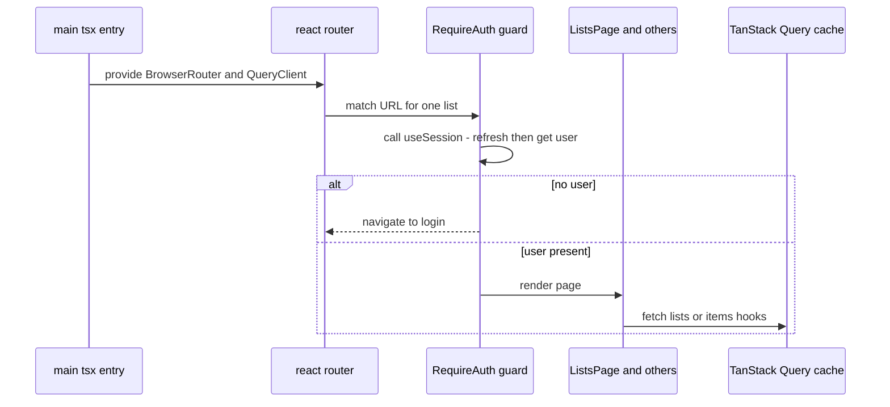
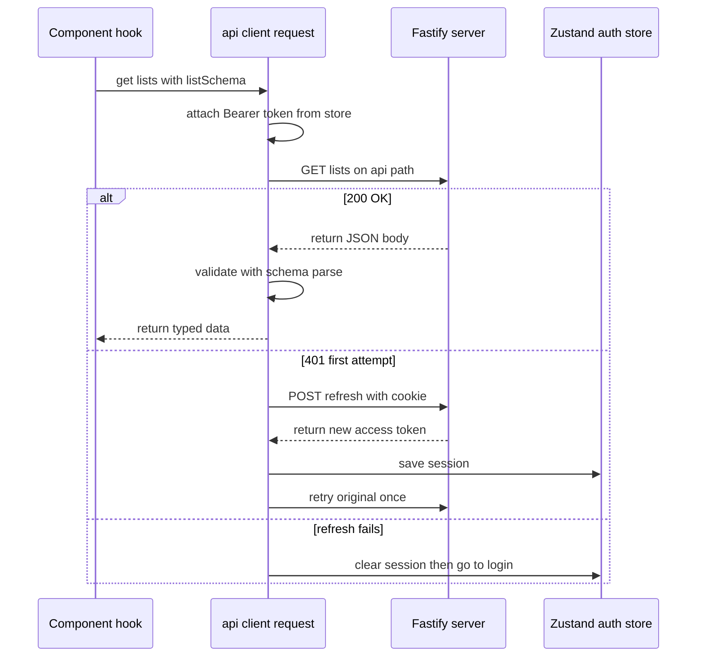
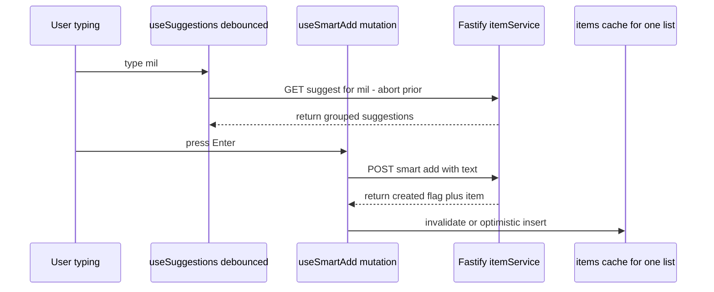
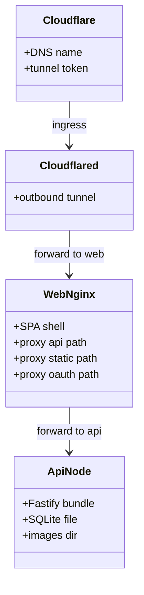

# PROJECT_LEARNING.md — Grocery List, file by file, for a backend developer

> Audience: strong backend experience, ~zero frontend experience. Goal: understand how this app is built by reading it in dependency order, one functional module at a time. Method: for every step — **what to read → what it does → BE analogy → why this library**.

How to use this guide:

1. Read top to bottom. Each step builds on the previous one.
2. Run commands in `bash` blocks to see things live.
3. All `mermaid` blocks render on GitHub **and** in Obsidian (they are written against Obsidian's older Mermaid parser — see the note below).
4. "Your turn" boxes are small hands-on checks. Do them — FE sticks only by doing.

```bash
cp .env.example .env   # once, set JWT_SECRET
docker compose up      # api on port 3000, web on 5173 (proxies api and static to api)
# or native: pnpm install && pnpm dev
```

> **Mermaid rendering note (Obsidian).** Obsidian ships an older Mermaid build with strict rules, which is why the diagrams in this doc look "reworded":
> - `:` is the separator character (e.g. `A->>B: label`, `A --> B : label`). A **second** colon inside the label text breaks parsing — so labels never contain literal colons. `web:5173` becomes `web on 5173`, `/lists/:listId` becomes `one list URL`. (The HTML entity `&#58;` renders as `:` and is a valid workaround — that's the `58;` trick — but plain rewording reads better.)
> - `"` `{` `}` `[` `]` `<` `>` `#` `;` inside sequence-diagram messages and participant aliases also break it — so no quoted strings, no JSON-looking payloads, no `&lt;` entities in labels.
> - `classDiagram` member lines treat `:` as a name-type separator — so class members never contain colons either (`api:3000` becomes `api on 3000`).
> - Entity-relationship arrows (`||--o{`) are **not** `classDiagram` syntax; they need an `erDiagram` block. The schema diagram below uses one.

---

## 0. Big picture first (10 minutes)

### 0.1 What this app is

Self-hosted grocery-list web app + REST API (think "Buy Me a Pie" clone). Runs on a tiny NAS (Synology DS223j, 1 GB RAM), exposed via Cloudflare Tunnel. REST API is first-class: humans use the React SPA, AI agents / Telegram / Alice voice assistant use tokens.

### 0.2 Monorepo layout

```text
package.json / pnpm-workspace.yaml / tsconfig.base.json / biome.json / vitest.config.ts
apps/api/        # Node.js + Fastify + Drizzle + SQLite backend
apps/web/        # React 18 + Vite SPA frontend
packages/shared/ # zod schemas + types shared by both (single source of truth)
docs/            # PROJECT.md, ARCHITECTURE.md, DATA_MODEL.md, API.md — normative specs
docker-compose*.yml, apps/*/Dockerfile, apps/web/nginx.conf
scripts/run-next-task.sh, Tasks/
```

BE analogy: monorepo = one repo with `backend/`, `frontend/`, `common/` Maven/Gradle modules. `pnpm-workspace.yaml` declares members (`apps/*`, `packages/*`); `@grocery/shared` is imported as `workspace:*` — like a local SNAPSHOT dependency, no registry publish needed.



### 0.3 Runtime topology (dev vs prod)



Key quirk to remember: **Fastify serves routes unprefixed** (`/lists`, `/auth/login`). The `/api` prefix exists only at the edge (Vite dev proxy, nginx prod) and is stripped there. `/static` is a real prefix (`@fastify/static`). This confuses every newcomer once — now you know.

---

## Phase 1 — Tooling and contracts (read these before any code)

### Step 1. Root configs — `package.json`, `pnpm-workspace.yaml`, `tsconfig.base.json`, `biome.json`, `vitest.config.ts`

**Read:** those 5 files at repo root.

**What they do:**

| File | Purpose | BE analogy |
|---|---|---|
| `package.json` (root) | Only scripts: `dev` (`pnpm -r --parallel dev`), `build`, `test` (`vitest run`), `lint`/`format` (`biome check`) | Parent POM with aggregator goals |
| `pnpm-workspace.yaml` | Declares `apps/*`, `packages/*` as workspace | Maven `<modules>` |
| `tsconfig.base.json` | Strict TS: `strict`, `noUncheckedIndexedAccess`, `noUnusedLocals`, `verbatimModuleSyntax`, `moduleResolution: Bundler` | `-Werror` + `javac --strict` |
| `biome.json` | Linter + formatter (Biome replaces ESLint+Prettier here) | Checkstyle + Spotless in one binary |
| `vitest.config.ts` | Root test runner; maps `virtual:pwa-register/react` to a stub so node-side `vitest run` doesn't need a service worker | Surefire config + one mock |

**Library by library — what it is and why it is here:**

- **pnpm (package manager). What:** installs third-party JS packages from `package.json` into `node_modules`, driven by the `pnpm-lock.yaml` lockfile (exact versions, like `package-lock.json` / Maven dependency locking). **Why here:** three reasons. (1) Workspaces — one command (`pnpm -r dev`) runs every member's script; cross-imports (`@grocery/shared` as `workspace:*`) resolve locally with no registry publish, like inter-module SNAPSHOT deps. (2) Content-addressed global store — identical tarballs are stored once on disk (think Docker layer sharing), so installs are fast and small. (3) Strict `node_modules` layout — a package can only import what it declares; npm's flat hoisting silently lets you import undeclared transitive deps, pnpm fails loudly. **Alternatives:** npm (comes with Node but flat and slow), yarn (fine, but pnpm's strictness catches real bugs). **Where:** everywhere — every install/build/test command.
- **Biome (linter + formatter). What:** one fast Rust binary that both lints (unused vars, bad patterns — like Checkstyle/SpotBugs) and formats (indentation, quotes — like Spotless). **Why here:** the JS ecosystem default used to be ESLint + Prettier + a dozen plugins that fight each other; Biome replaces both with a single `biome check` and near-zero config (`biome.json`: 2-space indent, double quotes, 100-col width). `pnpm lint` / `pnpm format` at root cover the whole repo. **Where:** `biome.json`, enforced per task by the agent gate.
- **Vitest (test runner). What:** executes `*.test.ts(x)` files, provides `describe/it/expect` assertions and mocking — the Jest API, reimplemented on top of Vite so TypeScript and ESM work with no transpiler config (like JUnit 5 + Surefire discovering `*Test` classes). **Why here:** one runner for all three members (api + web + shared); API tests hit Fastify via `app.inject()` against `:memory:` SQLite (no sockets, fast), web tests use Testing Library + jsdom (a fake DOM in Node). The root `vitest.config.ts` exists only to stub `virtual:pwa-register/react` (a Vite-only virtual module) so the plain-Node test run can import web components. **Alternatives:** Jest (needs Babel/TS transform setup, slower), Node's built-in runner (no DOM, no component testing).
- **TypeScript strict (`tsconfig.base.json`). What:** static typing for JS, checked at build. The flags matter: `strict` (null checks — no billion-dollar null mistake), `noUncheckedIndexedAccess` (array indexing returns `T | undefined`, like forcing you to handle `Optional`), `noUnusedLocals/Parameters` (dead code fails the build), `verbatimModuleSyntax` (forces explicit `import type`, keeps types erasable for fast transpilers). **Why:** the codebase was largely agent-written; strictness is the guardrail that keeps it honest. Think `-Werror` permanently on.

Your turn: run `pnpm lint && pnpm test` (or `npx vitest run <file>`) and confirm green before touching code.

### Step 2. Environment and Docker — `.env.example`, `docker-compose.yml`, `docker-compose.prod.yml`, `docker-compose.override.yml`

**Read:** `.env.example` → `docker-compose.yml` → `docker-compose.prod.yml`.

**What it does:** `api` (node:20-alpine, dev-server with `--watch`), `web` (node dev server, publishes `5173`), `tunnel` (cloudflared, profile `tunnel` only). SQLite runs **in-process** — there is no `db` service. Volumes `data` (`/data/grocery.db`) + `uploads` (`/data/images`) persist state.

**Why no Postgres?** NAS has 1 GB RAM shared with DSM. Postgres idles at ~50–120 MB; SQLite in-process is < 5 MB and this workload is single-writer, low concurrency. WAL mode gives readers-writers concurrency without a server process. This is a deliberate cost decision documented in `README.md` / `docs/ARCHITECTURE.md` — same reason you'd embed H2/SQLite instead of running a DB pod for a side project.

BE mapping: env var → config bean; named volumes → persistent volumes / hostPath mounts.



**What each piece is:**

- **`.env` files. What:** the standard 12-factor config mechanism — secrets and host-specific paths live in environment variables, never in git (`.env` is gitignored, `.env.example` is the template). `docker-compose.yml` interpolates them (`${JWT_SECRET:?…}` even fails fast with a message when a required var is missing). **BE analogy:** Spring `application.properties` profiles / Kubernetes Secrets mounted as env.
- **Docker Compose services.** `api` mounts `./apps/api:/app` (live code reload via `--watch`, like hot-swap) plus the `data`/`uploads` volumes; `web` mounts `./apps/web:/app` and waits for `api` healthy (`wget /health`) before starting — the `depends_on: service_healthy` ordering guarantee. `tunnel` runs `cloudflare/cloudflared` with an outbound-only tunnel (no inbound ports on the NAS — the reverse of `kubectl port-forward`), started explicitly via `--profile tunnel` so laptop dev never launches it by accident.

### Step 3. The contract package — `packages/shared/src/index.ts` (+ `package.json`, `index.test.ts`)

**Read:** `packages/shared/package.json` → `src/index.ts` (467 lines, read fully — it's the Rosetta Stone).

**What it does:** Every request/response shape as **zod schemas** + inferred TS types: auth (`loginRequestSchema`), lists, categories (`hexColorSchema`), items, prices (money as decimal on the wire, `priceCents` integer in DB), suggest/search, images (`MAX_IMAGE_UPLOAD_BYTES = 2MB`), OAuth-for-Alice constants, Telegram constants, API tokens (`glc_` prefix).

**BE analogy:** Protobuf/Thrift IDL + generated stubs, except the "IDL" is executable: `z.infer<typeof schema>` gives you the type, `.parse()` gives you runtime validation. Backend validates inbound, frontend validates outbound ("validate at boundaries" per `docs/CONVENTIONS.md`).

**Library — zod (v4). What:** a runtime validation library with static type inference. You declare `z.object({ title: z.string().trim().min(1) })` once; TypeScript derives the type (`z.infer<…>`) for the compiler and `.parse(data)` checks unknown input at runtime (throws on mismatch). One declaration serves both worlds — unlike plain TS interfaces (types only, erased at runtime, cannot validate) or hand-written validators (no types). **Why here specifically:** it is the *only* runtime dependency of `@grocery/shared`, so the same schema object validates the request body in `apps/api/src/routes/*` **and** validates the fetch response in `apps/web/src/lib/api-client.ts`. Contract drift between BE and FE becomes structurally impossible: both sides import the same symbol. **Alternatives:** JSON Schema (no type inference, verbose), class-validator (decorator-based, backend-only, cannot ship to the browser bundle cleanly), hand-written interfaces + manual checks (drift guaranteed). **Where:** `packages/shared/src/index.ts` (all schemas), consumed in every route and every `features/*/api/*.ts` fetcher. Your turn: pick `createItemRequestSchema` and trace its import in `apps/api/src/routes/items.ts` and `apps/web/src/features/items/api/items-api.ts` — same symbol, both sides.

---

## Phase 2 — Backend (`apps/api/`)

Read backend in this order: config → DB → plugins → services → routes → app wiring → extras.

### Step 4. Config — `apps/api/src/config.ts` (+ `config.test.ts`)

**What:** `envSchema` (another zod schema, this time over `process.env`) parses env vars with defaults and coercions (`z.coerce.number()` turns the string `"3000"` into the number `3000` — env vars are always strings, like system properties). `loadConfig()` then applies **fail-fast production guards**: `JWT_SECRET`, `CORS_ORIGIN`, `TELEGRAM_*` must be set in prod, otherwise boot throws with a message pointing at `.env.example`.

**Why this pattern:** 12-factor app — config from env, validated once at boot, injected as a typed `AppConfig` object into `buildApp()`. BE analogy: Spring's `@ConfigurationProperties` with validation failing startup instead of NPE at 3 AM. The alternative (reading `process.env` ad hoc in every module) scatters defaults, typos, and missing-secret bugs across the codebase; centralizing it makes "what does this service need to run?" answerable in one file (`config.ts` + `.env.example`).

Note `CORS_ORIGIN` handling: with `credentials: true`, reflecting any origin is a security hole, so prod requires an explicit allowlist. Dev defaults to `true` (allow all) for laptop convenience.

### Step 5. Database — `apps/api/src/db/schema.ts`, `client.ts`, `migrate.ts`, `drizzle.config.ts`, `drizzle/`, `scripts/seed.ts`

**Read:** `schema.ts` first (the whole file — it's short and normative, mirrors `docs/DATA_MODEL.md`).

**Tables (ER diagram — an `erDiagram` block, the correct Mermaid type for this):**



> The full column list (timestamps, token hashes, OAuth TTLs, Telegram chat defaults) is in `apps/api/src/db/schema.ts` — the diagram above shows the relations to memorize; the file is the normative detail. (Member names use dashes because Mermaid entity names cannot contain underscores next to relationship syntax in some parsers; the real table names use underscores: `refresh_tokens`, `price_observations`, …)

**BE notes:**

- IDs are `cuid2` (`@paralleldrive/cuid2`) — collision-resistant, URL-safe, sortable-ish, no coordination needed (like UUIDv4 but shorter). Generated in app code, not DB sequences.
- Passwords: `bcryptjs` (pure JS bcrypt — no native build, important for ARM Docker builds). Tokens/secrets/codes: **sha256 hash only** in DB; plaintext returned once at creation. Same discipline as storing only password hashes.
- Money: `priceCents` integer in DB (no float rounding), decimal `price` on the API.
- `categoryId` FK is `onDelete: restrict` — you can't delete a category that still has items (service must move/delete items first). Most other FKs are `cascade`.
- `items.usageCount` + `item_buy_history` (last 5 per item) power suggestions and "last bought" badges.

**Library by library — what each piece is and why:**

- **Drizzle ORM (`drizzle-orm` + `drizzle-kit`). What:** a thin, SQL-shaped query builder, not a DataMapper. You write `db.select().from(items).where(eq(items.listId, id))` — it looks like SQL, it type-checks against the schema, and it returns plain row objects. No entity manager, no lazy loading, no change tracking session (compare JPA/Hibernate). `drizzle-kit generate` diffs `schema.ts` into versioned SQL migration files in `drizzle/`; `db/migrate.ts` applies them at boot (idempotent — like Flyway). **Why here:** three properties the alternatives lack simultaneously — tiny memory footprint (no query-engine binary, critical for the 150 MB container budget), explicit SQL you can reason about, and migrations as reviewable SQL files. **Alternatives:** Prisma (excellent DX but ships a ~20–50 MB query engine — blows the NAS RAM budget), TypeORM/Sequelize (decorator magic, implicit queries, heavy), raw `better-sqlite3` strings everywhere (no type safety). **Where:** `db/schema.ts` (table definitions), every `services/*.ts` (queries), `db/migrate.ts` (boot migration), `drizzle/` (SQL history).
- **better-sqlite3. What:** a synchronous SQLite driver for Node — the database engine runs *inside* the Node process (no socket, no separate server process; function call = query). Synchronous means no connection pool to tune: one handle, one writer at a time, which is exactly SQLite's execution model anyway. **Why here:** fastest Node SQLite driver, zero operational cost (< 5 MB RAM vs 50–120 MB idle for Postgres on a 1 GB NAS). The workload is single-writer/low-concurrency (a family shopping list), so a server DB buys nothing. **Alternatives:** `node:sqlite` (Node's built-in — newer, less battle-tested when chosen), `sql.js` (SQLite compiled to WASM — portable but slower, in-memory only). **Where:** `db/client.ts` (open + pragmas), injected into Fastify via `plugins/db.ts`.
- **SQLite WAL mode. What:** `journal_mode=WAL` changes the transaction journal so readers don't block behind a single writer (readers see the last committed snapshot). Plus `busy_timeout` (wait instead of instantly failing on lock) and `foreign_keys=ON` (SQLite skips FK enforcement unless asked — unlike Postgres). **Why:** the standard trio that makes SQLite viable as a small web-app database. **Where:** `db/client.ts`, documented in `docs/ARCHITECTURE.md`.
- **cuid2 (`@paralleldrive/cuid2`). What:** an ID generator producing short, URL-safe, collision-resistant strings (e.g. `clh…`), generated in application code. **Why over auto-increment integers:** no coordination with the DB (works offline, works in tests), non-enumerable (no `/items/124` guessing), no information leak (no creation-order/count disclosure). **Why over UUIDv4:** shorter in URLs and logs. **Where:** every `service` that inserts a row.
- **bcryptjs. What:** password hashing (bcrypt: salted, deliberately slow — ~100 ms per hash — so stolen hashes resist brute force). The `js` variant is pure JavaScript with no native compilation step. **Why the JS variant:** `better-sqlite3` and `sharp` already need compilation in Docker; `bcrypt` (native) would add another ARM build risk for zero security benefit (bcryptjs implements the same algorithm). **Where:** `services/authService.ts` (register/login compare), `scripts/seed.ts` (demo users).
- **`scripts/seed.ts` + `db:seed`. What:** inserts the first admin user, a member user, and demo lists/items. **Why:** a fresh clone boots to a usable state with one command; also the pattern API tests reuse (in-memory seed per suite).

### Step 6. Fastify plugins — `apps/api/src/plugins/{db,auth,list-auth,error-handler}.ts`, `errors.ts`

**Read:** `db.ts` → `auth.ts` → `list-auth.ts` → `error-handler.ts` + `errors.ts`.

BE analogy: Fastify plugins = Servlet filters / Spring interceptors + DI bindings. `app.decorate("db", …)` attaches the DB handle to every request (like a request-scoped bean). `registerDb` injects either real on-disk DB (prod/`index.ts`) or `:memory:` (tests) — constructor injection via `AppDependencies`.

- `auth.ts` (`@fastify/jwt`): verifies `Authorization: Bearer <15-min JWT>`; also accepts `glc_…` API tokens and OAuth tokens where appropriate. Short-lived access + rotating refresh is the standard "stolen token is useless in 15 min" trade-off.
- `list-auth.ts`: per-list RBAC — loads membership, enforces OWNER > EDITOR > VIEWER. Think method-level `@PreAuthorize("hasRole('EDITOR')")` but resolved per resource row.
- `error-handler.ts`: maps domain errors → `{ error: { code, message } }` envelope with correct HTTP status (`VALIDATION_ERROR`→400, `UNAUTHORIZED`→401, `FORBIDDEN`→403, `NOT_FOUND`→404, `CONFLICT`→409). Frontend's `ApiClientError` parses exactly this shape.

**Library by library:**

- **Fastify (v5). What:** the HTTP server framework — routing, middleware ("plugins"), request/response lifecycle. The Express successor: async handlers natively (no `next()` callback chains), a faster router, and plugin encapsulation (each plugin gets a scoped instance, like nested Spring contexts). **Why over Express:** throughput on a weak ARM CPU, first-class async/await error propagation (thrown errors reach the error handler instead of hanging), and schema-hook integration points. **Why not NestJS:** decorator-heavy DI framework — real power, but an order of magnitude more abstraction than a 15-table CRUD API needs. **Where:** `app.ts` (`buildApp`), every `routes/*.ts`.
- **`@fastify/jwt`. What:** signs (`app.jwt.sign`) and verifies (`request.jwtVerify`) JSON Web Tokens — short-lived, stateless credentials (user id + role, HMAC-signed with `JWT_SECRET`; verification needs no DB lookup, like a signed timestamp). **Why:** 15-minute access tokens limit the blast radius of a leaked token; the refresh cookie (below) restores the session silently. **Where:** `plugins/auth.ts`, `services/authService.ts` (issue).
- **`@fastify/cookie`. What:** parses `Cookie` headers and serializes `Set-Cookie` (signing, `HttpOnly`/`Secure`/`SameSite` flags, `Path` scoping). **Why:** the refresh token travels as an `HttpOnly` cookie scoped to the refresh path — invisible to page JavaScript, so an XSS hole cannot steal the long-lived credential (the short-lived access token in memory is the only thing JS ever holds). **Where:** `app.ts` registration, `routes/auth.ts` (set/clear cookie).
- **`@fastify/cors`. What:** answers CORS preflight (`OPTIONS`) and sets `Access-Control-Allow-Origin` on responses — the browser mechanism that decides whether a page from origin A may call an API on origin B. **Why:** mandatory once frontend and API have different origins in any environment; misconfigured CORS is the classic "works in curl, fails in browser" bug. Prod uses an explicit allowlist (see Step 4). **Where:** `app.ts` one-liner.
- **`@fastify/helmet`. What:** sets secure HTTP headers (`Content-Security-Policy`, `X-Content-Type-Options`, …) — the low-effort hardening checklist. **Why:** defense in depth for free; notably `crossOriginResourcePolicy` is relaxed here so the web origin may load `/static` images cross-origin. **Where:** `app.ts` one-liner.
- **`@fastify/multipart`. What:** parses `multipart/form-data` uploads with size limits (`MAX_IMAGE_UPLOAD_BYTES` = 2 MB from shared). **Why:** item photos arrive as multipart; the plugin enforces the size cap *during streaming* instead of buffering unbounded input into memory (a DoS vector on 1 GB RAM). **Where:** `app.ts` limits, `routes/items.ts` image endpoint.
- **`@fastify/static`. What:** serves files from disk (`/data/images`) under the `/static/` URL prefix with cache headers. **Why:** photos are content, not API responses — serving them as static files with `Cache-Control: immutable` (filenames contain a content hash, so bytes at a URL never change) lets browsers/CDN cache forever. **Where:** `app.ts` registration; consumed by every `` in the frontend.

### Step 7. Services (pure domain logic) — `apps/api/src/services/*.ts`

**Read in order:** `authService.ts` → `userService.ts` → `listService.ts` → `categoryService.ts` → `itemService.ts` (+ `textMatching.ts`) → `priceService.ts` → `searchService.ts` → `imageService.ts` → `apiTokenService.ts`.

Services take `(db, …params)` and contain all SQL + rules; routes only do HTTP plumbing. This is intentional (Anemic-route / Rich-service, a.k.a. hexagonal-ish): services are unit-testable without HTTP (`itemService.test.ts`, `textMatching.test.ts` are good examples).

Key behaviors to note:

- `authService`: bcrypt compare, issue JWT (15 min) + refresh token (30 d, sha256-stored, rotating, HttpOnly `refresh_token` cookie scoped to `/api/auth`), logout revokes.
- `itemService.smartAdd(text)`: exact → substring → fuzzy (`textMatching.ts`: normalization, Levenshtein-ish) → create. Returns `{ created, matchedBy, item }` so UI can say "found" vs "created".
- `itemService.move/reorder`: status transitions (`TO_BUY`↔`BOUGHT`), `boughtAt` + `item_buy_history` pruning, `sortOrder` rewrite for drag-and-drop.
- `imageService`: `sharp` resizes to 600px webp, content-addressed filename `<id>-<hash>.webp` (immutable cache — URL changes on re-upload, so CDN/browser can cache forever).
- `priceService` / `searchService`: cursor pagination (`DEFAULT 50 / MAX 100`), newest-first.



**Library — sharp. What:** a Node binding to libvips (the fast C image pipeline) for resize/convert/compress. **What it does here:** every uploaded photo is resized to a 600 px long edge and encoded as WebP (`<itemId>-<contentHash>.webp`). **Why two-stage resize:** the browser already downscales to 1200 px before upload (saves mobile bandwidth), but the client cannot be trusted — `sharp` on the server is the safety net guaranteeing bounded storage and a uniform format no matter what bytes arrive. **Why sharp over jimp/pure-JS:** 10–50× faster (native code) with lower memory — matters on ARM with 128 MB container cap. **Where:** `services/imageService.ts`; filenames served via `@fastify/static`.

### Step 8. Routes (HTTP adapters) — `apps/api/src/routes/*.ts`

**Read:** `health.ts` → `auth.ts` → `lists.ts` → `categories.ts` → `items.ts` → `prices.ts` → `search.ts` → `users.ts` → `api-tokens.ts`.

Each file = one resource, each `*.test.ts` next to it = contract test via `buildApp` + in-memory DB (`app.test.ts` shows the pattern: inject fake DB, `app.inject()` HTTP calls, no sockets). `docs/API.md` is normative — route behavior must match it verbatim.

Special attention:

- `auth.ts`: login, refresh and logout endpoints, plus Telegram session and link endpoints (delegates to telegram service).
- `api-tokens.ts`: creating a token returns plaintext `glc_…` **once**; listing returns metadata only.
- `users.ts`: admin-only CRUD (first user bootstrapped as admin — see seed/docs).

### Step 9. App wiring — `apps/api/src/app.ts`, `index.ts`, `dev-server.mjs`, `uploads-probe.ts`

**Read:** `app.ts` (112 lines — the whole backend in one glance) → `index.ts` → `uploads-probe.ts`.

`buildApp(config, {db})` registers everything in order: error handler → db → uploads dir → `helmet/cors/cookie/multipart/static` → `registerAuth` → domain routes → alice/telegram routes. `index.ts` loads config, opens the real SQLite file, runs migrations, `listen()`. `uploads-probe.ts` fail-fasts if `/data/images` isn't writable (common named-volume ownership bug) instead of 500ing on first upload.

**Tooling — tsx, esbuild, dotenv. What:** `tsx` runs TypeScript directly in dev (no separate compile step — like `ts-node` but fast, backed by esbuild); `esbuild` bundles the production server into one minified `dist/server.js` in milliseconds (native modules `better-sqlite3` and `sharp` stay external — see `scripts/bundle.mjs`); `dotenv` loads `.env` into `process.env` for native (non-Docker) runs. **Why:** dev loop stays instant, prod artifact stays small and single-file, native addons keep working. **Where:** `apps/api/package.json` scripts, `scripts/bundle.mjs`.

### Step 10. Bots and voice — `apps/api/src/telegram/`, `alice/`, `oauth/`

Three independent entry points reusing the same services. Skim in this order:

1. **Telegram** (`telegram/{initData,service,routes,botWebhook,botDialog,extract,botApi,chatDefaults}.ts`): `initData` = HMAC-signed query string from Telegram WebApp (verified with bot token — like webhook signature verification in Stripe/GitHub). The link endpoint (email+password once) binds `telegram_id`; later the session endpoint logs in passwordless. `botWebhook` receives Bot API updates, `extract` parses free text ("milk 2x") deterministically or via JEV LLM (`EXTRACTION_BACKEND=jev`, OpenRouter). `chatDefaults` remembers one list per chat.
2. **Alice / Yandex** (`alice/{protocol,nlu,dialog,webhook,links,tts}.ts` + `oauth/`): Standard OAuth2 authorization-code flow against the authorize and token endpoints (`oauthService.ts`), then voice intents hit the Alice webhook. `alice_links` binds one list per user.
3. **Why separate?** Transports differ (HTTP REST vs Bot webhook vs voice JSON), domain doesn't. Same `itemService`/`listService` underneath — ports-and-adapters.



---

## Phase 3 — Frontend (`apps/web/`)

> Mindset shift for BE devs: there is no request scope. The SPA is a long-lived stateful client (like a desktop app) that talks to your REST API. State lives in three places: **server cache** (TanStack Query), **client session** (Zustand), **URL** (React Router). Confusing which is which causes most FE bugs.

### Step 11. Build and shell — `apps/web/package.json`, `vite.config.ts`, `index.html`, `src/main.tsx`, `src/app.tsx`, `src/index.css`

**Library by library:**

- **Vite (v5) + `@vitejs/plugin-react`. What:** the frontend build tool and dev server. Dev: serves modules as native ES imports — no bundling, millisecond hot reload ("HMR": edit a component, the browser updates without losing state, like hot-swap on steroids). Prod: bundles + minifies + content-hashes assets via Rollup. The plugin adds JSX transform and Fast Refresh. **Why over webpack/CRA:** 10–100× faster dev loop on a laptop; config is ~30 lines (`vite.config.ts`) instead of a webpack novel. **What it does here specifically:** the dev proxy forwards `/api` (stripping the prefix) and `/static` to `api:3000` — deliberately mirroring `nginx.conf` so dev topology equals prod topology (Step 16). **Where:** `vite.config.ts`, `package.json` scripts (`dev`, `build`, `preview`).
- **Tailwind CSS (v4) via `@tailwindcss/vite`. What:** utility-first styling — instead of writing CSS classes in separate files (`.row { display:flex; … }`, BEM naming), you compose atomic utilities inline: `className="flex gap-2 text-sm"`. The build scans sources and emits only the used CSS (deduplicated "design system"). **BE analogy:** inline styles, but constrained to a scale and shared across the app. **Why:** no CSS file archaeology, no naming debates, consistent spacing/colors; v4 is Vite-native (no PostCSS config needed). `index.css` holds just the Tailwind import + theme tokens. **Where:** every `*.tsx` `className`, `src/index.css`.
- **React (18). What:** the UI library: components are functions of state (`(props, state) → DOM`), re-rendered on change with a virtual-DOM diff. You don't cross this bridge in the guide — treat components as templates with reactive variables. **Where:** everything under `src/`. `main.tsx` = entry: creates `QueryClient`, `BrowserRouter`, mounts `<App/>`. `app.tsx` = route table: `/login`, `/` + `/lists/:listId`, item details, categories, members, `/users`, all wrapped in `RequireAuth` / `RedirectIfAuthenticated` guards. `UpdateToast` (PWA) floats above everything.



### Step 12. Transport — `apps/web/src/lib/{api-client.ts,api.ts,pwa-config.ts}`, `src/stores/auth-store.ts`

**Read:** `api-client.ts` (fully, 207 lines) → `auth-store.ts` (20 lines) → `api.ts`.

- `createApiClient(adapter)` is a typed `fetch` wrapper: prefixes `API_BASE_PATH` (`/api`), attaches `Authorization: Bearer`, `credentials: same-origin` (sends refresh cookie), validates every response with the **shared zod schema**, throws `ApiClientError{status,code}`. On 401 (except login/refresh paths) it does **single-flight silent refresh** (`POST /auth/refresh`) and retries once — concurrent 401s share one refresh promise (`refreshInFlight`).
- `auth-store.ts` (`zustand`): `{ accessToken, user }` in memory only, **never localStorage** (XSS would steal a persisted token; in-memory + refresh cookie is the safer split). `authAdapter` bridges store ↔ client without import cycles.
- `api.ts` wires singleton `api = createApiClient(authAdapter)`.

**Library — Zustand (v5). What:** a ~1 KB global client-state store with a hook API: `useAuthStore(s => s.user)` subscribes a component to one slice (re-renders only when that slice changes — unlike bare React Context, which re-renders all consumers on any change). No actions/reducers/dispatch boilerplate: `useAuthStore.setState({…})` mutates directly. **Why here (not Redux):** the global *client* state is tiny — session `{accessToken, user}` plus a couple of UI bits. Redux Toolkit would be a cannon for a sparrow (store setup, slices, thunks). **The critical rule:** server state never lives in Zustand — it lives in TanStack Query (next step). Session-in-Zustand + data-in-Query is the architecture; mixing them is the most common FE bug. **Alternatives:** Redux (justified at 10× this UI complexity), Jotai/Recoil (atomic models — fine, but Zustand's single store maps better to "the session"). **Where:** `stores/auth-store.ts`, consumed via `authAdapter` in `lib/api-client.ts` and by `session-guards.tsx`.



### Step 13. Server-state pattern — one feature end to end (`features/lists/` + `features/auth/`)

**Read:** `features/lists/api/lists-api.ts` → `hooks/use-lists.ts` → `pages/lists-page.tsx` → `components/*` → `features/auth/hooks/use-session.ts,use-login.ts,use-logout.ts` → `components/session-guards.tsx`.

Pattern (repeats for every feature):

1. `api/*.ts`: thin functions calling `api.get/post/patch/del(path, sharedSchema)`.
2. `hooks/use-*.ts`: `useQuery({ queryKey, queryFn })` for reads, `useMutation` + `queryClient.invalidateQueries` for writes. Query keys include IDs (`["lists"]`, `["lists", id]`, `["items", listId]`).
3. `pages/*.tsx`: compose hooks + presentational components; URL params (`useParams`) are the selected IDs.
4. `components/*.tsx`: dumb render + callbacks (easy to test with Testing Library).

**Library by library:**

- **TanStack Query (v5, `@tanstack/react-query`). What:** the client-side *server-state* manager — a cache-aside layer over HTTP with superpowers: query keys as cache keys (`["items", listId]`), request deduplication (two components asking the same key = one fetch, like singleflight), background refetch, retries, and `invalidateQueries` after mutations (write-through invalidation instead of manual cache surgery). Mutations support optimistic updates with rollback (`onMutate` snapshot → apply → `onError` restore). **Why not `useEffect` + `fetch`:** hand-rolled fetching recreates the bug farm — double fetches in StrictMode, race between slow/fast responses, no dedup, stale screens after writes. Query centralizes all of it. **BE analogy:** cache-aside + singleflight + stale-while-revalidate, keyed like `lists:{id}` in Redis. **Alternatives:** SWR (lighter, Vercel's — fewer patterns for optimistic updates), Apollo Client (GraphQL-only, N/A), Redux + thunks (boilerplate, manual cache). **Where:** every `features/*/hooks/use-*.ts`. Your turn: open `use-lists.ts`, find `useQuery` + `useMutation`, and note which `invalidateQueries` fire after create/rename/delete — that's the cache-consistency protocol.
- **React Router (v7, `react-router-dom`). What:** maps URLs to components client-side (`/lists/:listId` → `<ListsPage/>` with `useParams()`), with history/back-button support and no full page reload. **Why:** the URL is the source of truth for navigation state (selected list/item) — deep-linkable, refresh-safe, shareable. Without it, "which list am I looking at" would live in fragile component state that dies on reload. **BE analogy:** server-side routing (`@GetMapping`) resolved in the browser. **Where:** `app.tsx` (route table), `session-guards.tsx` (`Navigate`), pages via `useParams`/`useNavigate`.
- **React Hook Form + `@hookform/resolvers` + zod. What:** form state library built on *uncontrolled* inputs (reads DOM values at submit instead of re-rendering per keystroke — the perf-correct approach), with per-field validation errors; `resolvers` plugs a zod schema in as the validator. **Why:** login/create/rename forms validate against the *same shared schemas* as the backend — one rule definition, enforced on both sides; errors are typed per field, submit payloads are typed. **Alternatives:** Formik (heavier, controlled inputs = re-render per keystroke), hand-rolled `useState` per field (works for one form, chaos for ten). **Where:** `login-page.tsx`, `create-list-form.tsx`, `item-edit-form.tsx`.
- **HeadlessUI (`@headlessui/react`). What:** unstyled but fully *accessible* UI primitives — `Dialog` (focus trap, ESC to close, ARIA roles), menus, listboxes. "Headless" = brings behavior, you bring Tailwind styling. **Why:** hand-rolled modals almost always ship accessibility bugs (focus escapes the dialog, screen readers misannounce, ESC unhandled); HeadlessUI gets it right once. **Where:** `item-edit-sheet.tsx` (`Dialog`), login/forms.

### Step 14. The main screen — `features/items/` (biggest feature, read selectively)

Order: `api/items-api.ts` → `hooks/{use-smart-add,use-suggestions,use-item-mutations,use-item-detail}.ts` → `lib/{grouping,age-badge,swipe-action}.ts` → `components/{add-item-input,item-row,item-sections}.tsx` → `pages/item-details-page.tsx`.

- `AddItemInput` + `use-smart-add`: bottom input box → smart-add endpoint → optimistic insert, suggestions dropdown from the suggest endpoint (debounced, `AbortSignal` cancels stale requests — like cancelling superseded futures).
- `item-row` + `use-long-press` + swipe (`swipe-action.ts`): mobile-first gestures; drag-and-drop reorder via **`@dnd-kit/{core,sortable,utilities}`** (accessible, touch-friendly DnD; older `react-beautiful-dnd` is unmaintained). Reorder posts `orderedIds` array — server rewrites `sortOrder` in one transaction (simpler than fractional indexing at this scale).
- `grouping.ts`: groups items by category for sections; `age-badge.ts`: "3 days in list" computed from `addedAt` (backend also returns `daysInList`).
- `item-details-page`: edit form, price history chart (**`uplot`** — tiny ~30 KB canvas chart, chosen over Chart.js/Recharts for the NAS/mobile budget), `buy-history`, `image-upload` (client resizes to 1200px via canvas + `resize-image.ts` before upload; server `sharp` re-resizes to 600px webp as safety net — defense in depth for bandwidth + storage).



**Library by library:**

- **`@dnd-kit/*`. What:** drag-and-drop toolkit (`core` = sensors/lifecycle, `sortable` = reorder presets, `utilities` = CSS transforms). Touch-first with accessibility (keyboard reorder, screen-reader announcements). **Why:** the main screen reorders items by dragging the `≡` handle on touch screens; `dnd-kit` handles pointer-vs-scroll disambiguation (`TouchSensor` with delay/tolerance) that hand-rolled DnD gets wrong. The classic alternative `react-beautiful-dnd` is abandoned. **Where:** `item-row.tsx` (`useSortable`), `item-sections*.tsx` (sortable context), reorder mutation in `use-item-mutations.ts`.
- **uPlot (`uplot`). What:** a ~30 KB canvas chart library (one focused API, no component framework). **Why:** the price-history sparkline needs "line chart, fast, tiny" — Chart.js or Recharts would add 10× the bytes for features (animations, theming) this app never uses, on a page served to phones over a tunnel. **Where:** `recent-prices.tsx` / price chart in item details.
- **Browser canvas resize (`resize-image.ts`, no library). What:** downscales the picked photo to a 1200 px long edge via `createImageBitmap` + canvas *before* upload. **Why first stage of the two-stage pipeline:** a 12 MP phone photo is ~4–6 MB; uploading it raw wastes mobile data and hits the 2 MB server cap — client resize keeps most uploads under the limit while `sharp` stays the enforcing second stage. **Where:** `lib/resize-image.ts`, used by `image-upload.tsx`.

### Step 15. Remaining features — `categories/`, `members/`, `users/`, `telegram/`, `pwa/`

| Module | Files | Notes for BE dev |
|---|---|---|
| `categories/` | `api/categories-api.ts`, `hooks/use-category-*.ts`, `components/category-*.tsx`, `pages/categories-page.tsx,category-items-page.tsx` | Same Query/mutation pattern; color = hex string validated by shared `hexColorSchema` |
| `members/` | `api/members-api.ts`, `hooks/use-list-detail.ts,use-member-mutations.ts`, `pages/members-page.tsx` | Permission UI over `list_members`; OWNER fixed at creation, only EDITOR/VIEWER assignable (see `assignableListRoleSchema`) |
| `users/` | `api/users-api.ts`, `hooks/use-users.ts,use-user-mutations.ts`, `pages/users-page.tsx` | Admin-only; gate in UI + enforced server-side (never trust the client) |
| `telegram/` | `webapp.ts`, `hooks/use-telegram-link.ts` | `window.Telegram.WebApp.initData` bridge; ready-handshake is a no-op in browsers |
| `pwa/` | `components/update-toast.tsx`, `lib/pwa-config.ts`, `vite-pwa.d.ts` | **PWA** = installable + offline-capable via service worker (plugin generates it; `workbox-window` prompts on update). Manifest icons in `public/`. Offline here = app shell cached; mutations still need network (no local DB sync — deliberate scope cut) |

**Library — `vite-plugin-pwa` + `workbox-window`. What:** turns the built SPA into a Progressive Web App with zero hand-written service-worker code: web manifest (name, icons, `display: fullscreen`), precached app shell (HTML/JS/CSS available offline), a runtime cache rule for `/static` images (cache-first — photos load from disk after first view), and an update prompt (`UpdateToast`) when a new bundle deploys. **Why generated, not hand-made:** service-worker update flows are notoriously error-prone (stale caches serving last month's bundle forever); the plugin wires registration + precache + update-check correctly. **Why PWA at all:** "install to home screen" + instant launch + surviving flaky mobile connectivity for reads. **Deliberate limit:** writes still need network (no local-first sync — out of scope). **Where:** `vite.config.ts` (`VitePWA(pwaPluginOptions)`), `lib/pwa-config.ts` (manifest + caching rules + tests), `features/pwa/components/update-toast.tsx`.

---

## Phase 4 — Delivery and quality

### Step 16. Prod delivery — `apps/api/Dockerfile`, `apps/web/Dockerfile`, `apps/web/nginx.conf`, `docker-compose.prod.yml`, `scripts/bundle.mjs`

**Read:** `apps/web/nginx.conf` → both Dockerfiles → `docker-compose.prod.yml`.

- `web` image: Vite build → static files served by **nginx** (`nginx.conf`): strip the api prefix when proxying to the api container, pass static and oauth paths through, immutable-cache hashed assets, no-cache on entry HTML and service worker and manifest, fallback unknown paths to the entry HTML for SPA deep links (server rewrites unknown paths to the shell — like a catch-all controller returning `index.html`).
- `api` image: multi-stage, `tsc` + **esbuild** bundle (`scripts/bundle.mjs`) with native modules (`better-sqlite3`, `sharp`) kept external. Note the `node:22-alpine` comment — `better-sqlite3@13` segfaults on a specific node:20 patch; the Dockerfile pins around it. Read comments there.
- `cloudflared` tunnel (profile `tunnel`, `TUNNEL_TOKEN`): no inbound ports on the NAS; outbound-only tunnel to Cloudflare, public hostname to the web container on 8080. BE analogy: reverse tunnel / `kubectl port-forward` in reverse, managed.



**What each piece is:**

- **nginx. What:** the production web server / reverse proxy in front of both artifacts: serves the static SPA bundle (hashed `/assets/*` cached immutably for a year, entry HTML never cached so deploys take effect) and proxies API, static-image and OAuth paths to the api container (stripping the `/api/` prefix so Fastify sees unprefixed routes — the same rewrite the Vite dev proxy does). **Why not serve the SPA from Fastify:** separation of concerns and correct caching semantics per path; nginx does this in ~30 lines (`nginx.conf`). **BE analogy:** Apache/Nginx fronting Tomcat — static + reverse proxy in one.
- **Multi-stage Dockerfiles. What:** build stage (full toolchain: python/make/g++ to compile `better-sqlite3` from source — no musl prebuilt exists) produces `dist/server.js` (esbuild bundle) + static web files; runtime stage copies only the bundle plus the two native modules' files (see the `cp -rL` dereferenced-symlink dance for `sharp`'s store slices). Final images stay small enough for the NAS. **Why local builds:** the NAS CPU (ARMv8, weak) cannot comfortably build; images are built on the laptop for `arm64` and shipped over.
- **cloudflared tunnel. What:** an outbound-only encrypted tunnel from the NAS to Cloudflare's edge; the public hostname routes to it, so zero inbound ports are opened on the home router. Started only with `--profile tunnel` + `TUNNEL_TOKEN`. **Alternatives:** port forwarding + Dynamic DNS (exposes the NAS to the whole internet), VPS reverse proxy (another bill).

Backup = copy the SQLite file + images dir (see `docs/ARCHITECTURE.md`, `docs/DEPLOYMENT*.md`). No dump tool needed — single file, WAL checkpoint first. Test restores on the laptop, not the NAS.

### Step 17. Tests, types, docs — `*.test.ts(x)`, `docs/`, `Tasks/`

- Tests colocate with code (`routes/*.test.ts`, `features/*/*.test.tsx`): API tests use `app.inject()` + `:memory:` DB (no sockets, fast); web tests use Testing Library + jsdom (`user-event` for realistic clicks/typing). Run `vitest run` from root.
- `docs/API.md` + `docs/DATA_MODEL.md` are **normative** — code must match them verbatim; change the spec in the owning task, not ad hoc. `docs/CONVENTIONS.md` = style/test/git rules.
- `docs/TASKS.md` + `EXECUTION_LOG.md` + `scripts/run-next-task.sh` = how this repo was AI-built (one fresh agent per task, verify, one commit). Useful context, not needed to learn the app.

---

## Appendix A — Library cheat-sheet (what + why + where, not just names)

| Area | Used | What it is (one line) | Why here (not X) | Where |
|---|---|---|---|---|
| BE framework | `fastify` 5 | Async HTTP server + plugins | Perf on weak ARM, async errors, encapsulation; not Express (older), not NestJS (heavy) | `app.ts`, `routes/*` |
| Validation | `zod` 4 | Runtime schemas + inferred types | Single contract shared BE/FE; not Joi (no types), not class-validator (BE-only) | `packages/shared/*` |
| ORM | `drizzle-orm` | Thin SQL-like builder + migrations | Tiny RAM, explicit SQL; not Prisma (engine RAM), not TypeORM (magic) | `db/*`, `services/*` |
| DB | `better-sqlite3` + SQLite WAL | In-process SQL engine | Under 5 MB; no Postgres server on 1 GB NAS | `db/client.ts` |
| IDs | `@paralleldrive/cuid2` | Short collision-proof IDs | Uncoordinated, non-enumerable; shorter than UUID | all services |
| Passwords | `bcryptjs` | Pure-JS password hashing | Same algorithm as bcrypt, no ARM build pain | `authService.ts` |
| Images | `sharp` (BE) + canvas (FE) | Native resize-to-WebP + client pre-resize | Fast, bounded storage/bandwidth; not jimp (slow) | `imageService.ts`, `resize-image.ts` |
| FE build | `vite` 5 + `@vitejs/plugin-react` | Instant dev server + Rollup prod bundle | Millisecond HMR, tiny config; not webpack/CRA | `vite.config.ts` |
| UI | `react` 18 + `react-router-dom` 7 | Components + client-side routing | Standard SPA, URL as navigation state; no SSR needed | `src/**/*.tsx` |
| Styling | `tailwindcss` 4 + `@headlessui/react` | Utility classes + accessible primitives | No CSS archaeology, no hand-rolled modal bugs; not MUI (heavy) | all `className`, dialogs |
| Server cache | `@tanstack/react-query` 5 | Cache + dedup + invalidate over HTTP | No hand-rolled fetch race bugs; not SWR (fewer patterns) | `features/*/hooks/*` |
| Client state | `zustand` 5 | 1 KB global store via hooks | Session only; not Redux (overkill), not Context (rerenders) | `stores/auth-store.ts` |
| Forms | `react-hook-form` + `@hookform/resolvers` | Uncontrolled forms + zod errors | Same schemas as BE, no per-keystroke rerenders; not Formik | `*-form.tsx`, login |
| DnD | `@dnd-kit/*` | Touch-first sortable drag-drop | Maintained + accessible; not react-beautiful-dnd (dead) | `item-row.tsx` |
| Charts | `uplot` | 30 KB canvas charts | 10× smaller than Chart.js for one sparkline | price chart |
| PWA | `vite-plugin-pwa` + `workbox-window` | Generated SW + update prompt | Correct caching without hand-written SW bugs | `pwa-config.ts`, `update-toast.tsx` |
| Auth | `@fastify/jwt` + `@fastify/cookie` | Short JWT + rotating refresh cookie | 15-min blast radius, XSS-safe split; no Redis session server | `plugins/auth.ts`, `routes/auth.ts` |
| Hardening | `@fastify/helmet,cors,multipart,static` | Headers, CORS, upload caps, static files | One job each; not hand-rolled middleware | `app.ts` |
| Tooling | `pnpm`, `biome`, strict `typescript`, `vitest`, `esbuild`, `tsx` | Fast install/lint/type/test/build loop | Speed + strictness; not npm/ESLint/jest/ts-node | root configs, `scripts/` |
| Prod edge | `nginx`, `cloudflared` | Static + reverse proxy, outbound tunnel | Correct caching, zero open ports; no port-forwarding | `nginx.conf`, compose |

## Appendix B — Suggested reading order (checklist)

- [ ] Root: `package.json`, `pnpm-workspace.yaml`, `tsconfig.base.json`, `biome.json`, `vitest.config.ts`
- [ ] Env/docker: `.env.example`, `docker-compose.yml`, `docker-compose.prod.yml`
- [ ] Contract: `packages/shared/src/index.ts`
- [ ] API: `config.ts` → `db/schema.ts` → `db/client.ts` → `plugins/*` → `services/authService.ts,userService.ts,listService.ts,categoryService.ts,itemService.ts,textMatching.ts,priceService.ts,searchService.ts,imageService.ts,apiTokenService.ts` → `routes/health,auth,lists,categories,items,prices,search,users,api-tokens.ts` → `app.ts` → `index.ts`
- [ ] Bots: `telegram/initData,service,routes,botWebhook.ts` → `oauth/*` → `alice/webhook,dialog.ts`
- [ ] Web: `vite.config.ts` → `index.html` → `main.tsx` → `app.tsx` → `lib/api-client.ts` → `stores/auth-store.ts` → `lib/api.ts`
- [ ] Feature slice: `features/lists/*` + `features/auth/*`, then `features/items/{api,hooks,lib,components,pages}`, then `categories,members,users,telegram,pwa`
- [ ] Delivery: `apps/web/nginx.conf` → `apps/*/Dockerfile` → `docker-compose.prod.yml` → `docs/ARCHITECTURE.md` → `docs/DEPLOYMENT.md`
- [ ] Norms: `docs/API.md`, `docs/DATA_MODEL.md`, `docs/CONVENTIONS.md`

## Appendix C — Glossary (BE → FE translations)

| You know (BE) | Here (FE) | File |
|---|---|---|
| DTO / IDL | zod schema + inferred type | `packages/shared/src/index.ts` |
| Controller | Route file + Service | `apps/api/src/routes/*`, `services/*` |
| Filter / interceptor | Fastify plugin | `apps/api/src/plugins/*` |
| Request scope | Query cache key + Zustand store + URL | `use-*.ts`, `auth-store.ts`, `app.tsx` |
| Cache-aside + singleflight | TanStack Query + `refreshInFlight` | `use-lists.ts`, `lib/api-client.ts` |
| Connection pool | `better-sqlite3` single handle + WAL | `db/client.ts` |
| Migration tool (Flyway) | `drizzle-kit generate/migrate` | `drizzle/`, `db/migrate.ts` |
| Reverse proxy rules | nginx locations / Vite proxy | `nginx.conf`, `vite.config.ts` |
| Cron/backup dump | Copy `.db` + images (WAL checkpoint) | `docs/ARCHITECTURE.md` |
| Servlet container | Vite dev server / nginx static | `vite.config.ts`, `nginx.conf` |
